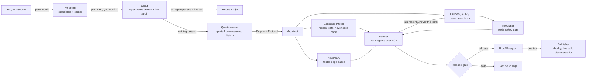
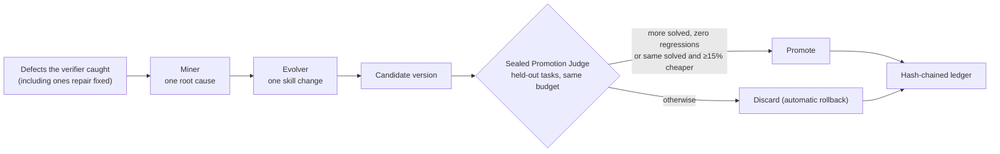

# FOUNDRY

**A self-improving factory for Fetch.ai agents that only ships agents that prove they work.**

Describe an agent in plain words inside **ASI:One**. FOUNDRY plans it with you, audits the agents that already exist on
**Agentverse** by calling them live, quotes the cost, takes payment through the **Payment Protocol**, and builds it with a
network of specialist agents. One model family writes hidden tests from your words alone; a different one writes the
code and never sees them. Nothing ships unless every test passes over the real **Agent Chat Protocol**, and every
failure FOUNDRY catches becomes a candidate improvement to its own skills, kept only if sealed, held-out tasks prove it.

> AIE Code Summit 2026 · Fetch.ai challenge "Agents That Prove Their Work"
> Track: **The System That Gets Better**, with **Trust but Verify**

---

## Live results (November 7, 2026, recorded on the demo machine)

| What happened | Evidence |
|---|---|
| Asked for an ISBN-13 validator. The Scout searched Agentverse with 4 queries, kept 79 live chat agents of 120 hits, called the best matches live, and none passed | quote card, `scout_audit` in the ledger |
| Built it: hidden tests by Meta Muse (never saw the code), code by GPT-5, run over ACP | **verified 10/10 on the first attempt** |
| Cost | **$0.045 actual vs $0.095 quoted**, measured per call and per role |
| Paid through the Payment Protocol (Stripe test mode), verified server side before building | `payment_completed` |
| Published to Agentverse as a hosted agent, then called by a fresh third-party agent | **live call PASS in 4.4 s**, reply `VALID` |
| Agentverse search for the new agent | **found after 0.3 s → DISCOVERABLE** |
| An earlier publish attempt whose live check failed | **release blocked, deployment torn down, cleanup confirmed** |
| Asked for a 2048 game in chat | **0/11 hidden tests, refused to publish** ("I won't publish unverified work") |
| "Teach FOUNDRY from this build" | root cause found (ASI:One card payload sent as an object, not a JSON string), lesson written, judged on **10 sealed tasks it never saw**: **zero regressions, cases 19 → 23 passing, $0.135 → $0.106 per build (21% cheaper) → promoted v0001 → v0002** |

Honest note on that promotion: both versions solved the same held-out tasks, so it was promoted under the cost rule
(same solved set, at least 15% cheaper). The previous version's score had been cached before the tenth sealed task was
added (4/9 vs 4/10), so the cost comparison is not over perfectly identical sets. We report it exactly as recorded.

---

## How it works



### The agent network

| Agent | Job | Where it runs |
|---|---|---|
| Foreman | the ASI:One front door: conversation, plans, quotes, cards, payments | Agentverse mailbox agent |
| Scout | multi-query Agentverse search, live re-tests, reuse offers | Agentverse mailbox agent |
| Architect | designs the agent or multi-agent system | Agentverse mailbox agent |
| Examiner | writes hidden acceptance tests from the request only (different model family) | Agentverse mailbox agent |
| Adversary | writes hostile and edge-case inputs | Agentverse mailbox agent |
| Builder | writes and repairs the code (GPT-5) | Agentverse mailbox agent |
| Integrator | static gate: hosted contract, no files, env, subprocess or eval | Agentverse mailbox agent |
| Runner | the only agent that executes generated code, isolated, no credentials | Agentverse mailbox agent |
| Card Validator, Quartermaster, Publisher, Ledger, Recovery, Miner, Judge, Evolver | card audit, pricing, deployment, evidence, retries, learning | next to the Foreman |

Role agents accept work **only** from the Foreman's address (authenticated by the uAgents envelope signature). Every
task and result between them travels through Agentverse and is logged with time and model spend:

```
[architect] task 8a2cfece from Foreman: plan          done in 7.5s,  model spend $0.0016
[examiner]  task 03f05b92 from Foreman: write_tests   done in 15.4s, model spend $0.0049
[adversary] task c5cd321a from Foreman: cases         done in 10.6s, model spend $0.0020
[builder]   task ee90512b from Foreman: build         done in 36.6s, model spend $0.0364
[integrator] task 38620e43 from Foreman: check        done in 0.0s
[runner]    task c37eb00d from Foreman: run           done in 19.4s
```

---

## The system that gets better



* **What changes:** FOUNDRY's skills, versioned under `skills/versions/`: lessons for the builder, model routing, and
  repair budgets. These are FOUNDRY's weights at the harness level.
* **What can never change:** the verifier. Tests and the static gate are locked on, and evolution may not route the
  Examiner to the builder's model family.
* **How it's judged:** on sealed tasks the learner never sees, with equal budgets, with transfer recorded (how similar
  the evaluation tasks are to the source failure: 0 identical, max similarity 0.07 in the live run).
* **Two loops:** inside a build, failures go back to the Builder for repair. Across builds, defects become skill
  changes that must earn promotion.

---

## Fetch.ai stack used

| Building block | How FOUNDRY uses it |
|---|---|
| uAgents addresses + Almanac | every role is its own agent; identity is the signed sender address, so there are no passwords |
| Agentverse | mailbox role agents, hosted published agents, profiles and READMEs written automatically |
| Agentverse search | the Scout's input, re-ranked by live evidence, never by listing claims |
| Agent Chat Protocol | how users, FOUNDRY, its roles and every generated agent talk; all tests run over it |
| Payment Protocol | RequestPayment → Stripe test checkout → verified server side before any build |
| ASI:One cards | starter carousel, plan review, capability quote, Proof Passport, publish result, evolution verdict |

---

## Try it

In ASI:One, message the Foreman:
`agent1q2garvq9gt9ycljy0mhaz0phzeemcvw6wtznpa4grzyu8h5yuawk2xyq0dh`

```
hi
build an agent that validates ISBN-13 numbers
find an agent that converts currencies
scoreboard
history
```

The agent FOUNDRY built and published today:
`agent1qgf3wlx7e7tmmmrfueesm2ea0f4tz962te6w8mp3ktkpjnz5xvzxjauml4f`

## Run it yourself

```bash
python -m venv .venv && source .venv/bin/activate
pip install -r requirements.txt
cp .env.example .env          # add your OpenAI, Meta, ASI:One, Agentverse (and optional Stripe test) keys
python -m foundry doctor      # every provider and API checked before anything is spent
python -m foundry selftest    # the harness catches a real defect and a real two-agent hand-off
python -m foundry serve       # Foreman + role agents; then talk to it in ASI:One
```

Agentverse mode (role agents as Agentverse mailbox agents):

```bash
python -m foundry serve-roles                                  # terminal 1
FOUNDRY_NETWORK_MODE=agentverse python -m foundry serve        # terminal 2
```

Other commands: `build`, `evolve`, `learn <job>`, `history`, `scoreboard` (in chat), `passport <job>`,
`passport-verify <path>`, `recheck <job>`, `rollback <version>`, `report`, `lint`.

## Integrity and safety

* **Release gate:** verified means every independent test passed on the final code, the static gate is clean, every
  card is valid, and for multi-agent systems the required agents were observed actually exchanging messages.
* **Proof Passport:** code SHA-256, skill digest, models, tests, observed collaboration, costs, limitations and
  evidence hashes, anchored in the ledger. `passport-verify` re-derives every digest.
* **Sandbox:** generated code runs in an isolated process with an empty environment (no API keys), resource limits
  and a static gate; an optional Docker mode adds no network and a read-only root.
* **Budgets:** every model call reserves its worst case before it is sent; actual cost replaces it afterwards.
* **Authorization:** only the address that requested a job can approve, pay for, publish or learn from it.
* **Ledger:** `evidence/ledger.jsonl` is hash-chained; edits are detectable.
* **Tests:** 143 offline tests for the control logic, plus real-runtime tests against the actual uAgents package.

More detail: [`docs/DETAILS.md`](docs/DETAILS.md), [`docs/ENGINEERING_REPORT.md`](docs/ENGINEERING_REPORT.md),
[`docs/EXPERIMENT.md`](docs/EXPERIMENT.md), [`docs/BUDGETS.md`](docs/BUDGETS.md).

## Roadmap

* Point the same proof-and-learning engine at existing GitHub repositories: find bugs, fix them, and open pull
  requests that carry a Proof Passport.
* RL fine-tuning of an open-weight builder from FOUNDRY's evidence (Agent Lightning, ART).
* One-tap ownership transfer of published agents into the requester's Agentverse account.

## Team

Vanshika Shah and Tirth Thakkar, San José State University.
